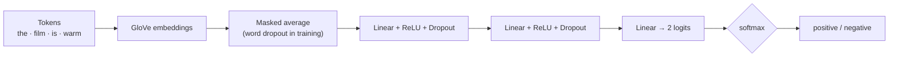
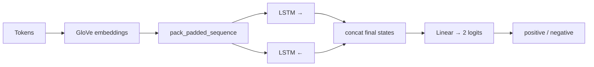
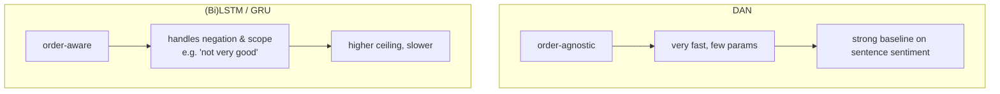

# Neural Sentiment Classifier

Binary sentiment classification (**positive** vs. **negative**) on the
[Stanford Sentiment Treebank](https://nlp.stanford.edu/sentiment/) with two
complementary neural architectures that share one training loop so you can
compare them directly:

- a **Deep Averaging Network (DAN)** — order-agnostic, tiny, and fast, and
- a **(Bi)LSTM / GRU** sequence model — order-aware and a little stronger.

Both start from pretrained **GloVe** embeddings. The repo runs end to end on a
small synthetic corpus with `--demo`, so you can try it without any downloads.

```bash
pip install -r requirements.txt

python scripts/train.py --demo --model dan          # train on toy data
python scripts/predict.py --checkpoint checkpoint.pt \
    --text "a warm , funny and genuinely engaging film"
# [positive 1.00] a warm , funny and genuinely engaging film
```

---

## The two models

### Deep Averaging Network

Average the word embeddings (ignoring padding and dropped tokens), then push
the single averaged vector through a feed-forward stack. No recurrence, no
attention — just composition by averaging.



### Bidirectional LSTM

Run an LSTM (or GRU) forward **and** backward over the embedded tokens, using
packed sequences to handle variable lengths, then concatenate the final
hidden states and classify.



---

## Why both?



A DAN cannot tell *"not very good"* from *"very good"* — it throws word order
away. The recurrent model keeps order, which is exactly what sentiment needs
for negation and intensifiers, and it pays off on the harder examples.

---

## Training on the real SST

Drop the processed parquet splits and a GloVe file into `data/` (see
[`data/README.md`](data/README.md)) and train on full sentences plus their
labelled sub-phrases:

```bash
python scripts/train.py --model lstm \
    --data-dir data --glove data/glove.840B.300d.txt
```

Word dropout regularises the DAN; the recurrent model uses packed sequences and
per-layer dropout. The best development checkpoint is kept automatically.

### Representative results (SST binary, root sentences)

| Model | Composition | Dev accuracy |
| ----- | ----------- | :----------: |
| DAN (2 layers, 300d) | averaging | ~85% |
| GRU (bi, 1 layer) | recurrence | ~86% |
| **BiLSTM (2 layers, 150d)** | recurrence | **~87–88%** |

The order-aware models consistently edge out the DAN, with the gap concentrated
on reviews that hinge on negation or contrast.

---

## Project layout

```
sentiment/
├── vocab.py        frequency-ranked vocabulary + tokenization
├── data.py         SST loading, padding, word-dropout torch dataset, toy corpus
├── embeddings.py   GloVe loading + embedding-matrix builder
├── models.py       DAN and RNNClassifier (LSTM / GRU, uni/bi)
└── trainer.py      shared train / evaluate / predict loop
scripts/
├── train.py        --demo or real SST; picks DAN / LSTM / GRU
└── predict.py      score sentences with a saved checkpoint
```
